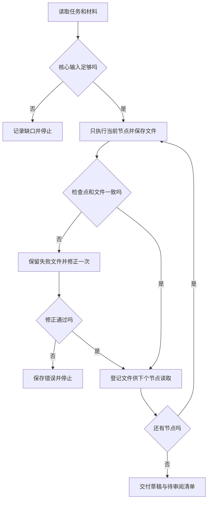

# 分节点执行补充规程

适用本地 Codex 和经过能力实测的其他本地 Runner。模型名称、地址和鉴权放在 Provider 配置中，Skill 不携带密钥。能返回文本不代表支持文件工具；换服务商后先跑真实读写探测。

每次只执行当前节点。读取任务、提示词、相关输入和本节点 Skill；需要详细规程时读取登记的 skillref/ 别名。前序文件通过 previous/节点/文件名读取，不凭聊天摘要重建数值或长稿。

## 输出与状态

节点先写实际内容文件，再写检查点。检查点记录 status、artifacts、source_locators、unresolved_questions；artifacts 中每项使用真实文件名和工具返回的 SHA256。source_locators 使用本节点实际读过的别名、页段或字段、原文摘录。摘录匹配仅证明文本一致，论断是否成立仍需阅读原文。

缺少核心数据、适用模板或关键数值无法核对，写 NEEDS_INPUT、blocking=true，列出具体所缺材料。没有填写团队基础，不能替换为“无”；不将缺失数据填零。教学草稿可保留的身份声明缺口可标 blocking=false；只有任务明确允许才继续。

格式检查失败时，保留原检查点和所有文件，只允许修正一次。修正版文件名增加 repair1，不能覆盖原文件。第二次仍失败即停止并保留日志。恢复时验证输入、配置、Skill、前序文件、渲染PDF与页面图指纹，改变材料后另建运行。

## 长文件处理

Grant 分别写立项依据、研究内容、研究基础与条件、声明和路线。每个正文片段使用 slots 字典，值为段落数组；具体槽位见节点清单。最后 assemble_word_content 读取这些实际片段合并，拒绝重复槽位和遗漏必需槽位。Paper 使用 sections 与 tables；Patent 按交底模板槽位写。模型不必在最后重新生成整份正文。

Word 节点实际调用 export_word 和 render_word；检查点列出DOCX与DOCX.render-manifest.json。保留原模板，按锁定hash的填写副本操作。Paper的Word是课程工作稿，PLOS原模板为LaTeX，二者不能混称。

数据Figure实际调用 plot_csv，保存SVG、PNG、统计、带源行号的清洗CSV和图注。误差线未定义时保留缺口，不自动选择置信区间。机制示意另保留可编辑关系图并标明假说，不能用数据散点工具替代。

## 执行顺序

## 验证范围

文件工具的实际执行、Provider工具往返、完整科研工作流、视觉检查和科学核验分别记录。没有真实API请求，不标记该模型已跑通；没有完整检索，不标记新颖性或可授权；没有研究者核验，不标记科学审核通过。
